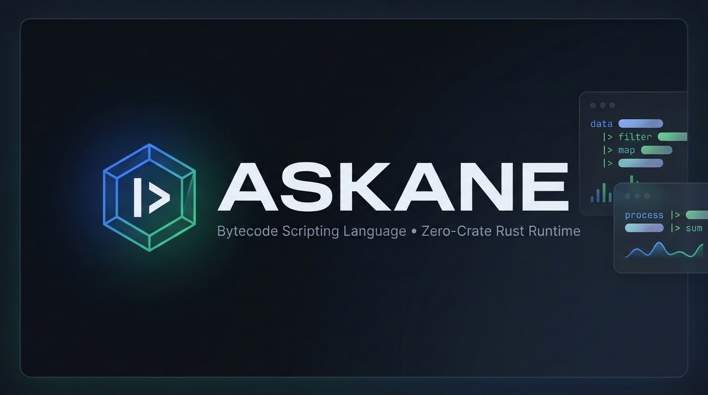

<div align="center">
  

  <h1>
    
    &nbsp;Askane (v0.17.1 Open Beta)
  </h1>

  <p>
    An experimental, bytecode-compiled scripting language written in Rust with <strong>zero external crate dependencies</strong>.
  </p>

  <p>
    <a href="https://github.com/askane-co/askane/actions/workflows/ci.yml">
      
    </a>
    &nbsp;&middot;&nbsp;
    <a href="docs/SYNTAX.md">Language Spec</a>
    &nbsp;&middot;&nbsp;
    <a href="SECURITY_AUDIT.md">Security Audit</a>
    &nbsp;&middot;&nbsp;
    <a href="ROADMAP.md">Roadmap</a>
  </p>
</div>

> **Transparency note**: This language and its runtime were designed and built in collaboration with **Gemini** (AI-assisted development). Published as an open beta so anyone can inspect the VM, run benchmarks, test the sandbox, and suggest improvements.

## Highlights

- **Single standalone binary**: lexer, AST parser, bytecode compiler, register/stack fast VM (`execute_fast`), and a rich standard library in pure Rust with zero Cargo dependencies.
- **Expression-first syntax**: `{ ... }` blocks, `if`/`else`, `match`, pipelines (`|>`, `|?>`, `|*>`, `|>=`, `_`), inline `recover`, tagged templates (`log"..."`, `sql"..."`), `struct`, `set`, `bytes`, and built-in `spec` tests.
- **Sandbox & contracts**: default-deny permissions for network, filesystem outside root, env, args, clipboard, global input, and process execution, plus `needs` declarations and `sandbox { ... }` privilege attenuation.
- **Built-in tooling**: multiline REPL, `askane check`, `askane fmt`, `askane test [--deterministic] [--update-snapshots]`, `askane permissions`, `askane init`, `askane setup`, benchmark suite (`bench/`), and Windows Askane Studio v2 (`--gui`) with project explorer, tabs, search/replace, line numbers, and permissions toggles.

## How It Works Under the Hood

Askane runs as a classic 4-stage pipeline in a single standalone binary:

1. **Lexer** (`src/lexer.rs`): scans `.ask` source code into tokens with line/column spans.
2. **Parser** (`src/parser.rs`): builds an AST (`src/ast.rs`). Blocks, `if`/`else`, and `match` are expressions, and `|>` desugars `x |> f(a)` into `f(x, a)`.
3. **Bytecode Compiler** (`src/compiler.rs`, `src/bytecode.rs`): compiles the AST into stack-VM opcodes, resolving local variable slots, lexical closures (upvalues), loops, and `match` jumps.
4. **Stack VM & Modules** (`src/vm.rs`, `src/value.rs`, `src/modules/`): executes bytecode on a value stack with built-in functions and standard modules (`math`, `fs`, `sys`, `json`, plus Windows-native `http`, `gfx`, and `mem` using system Win32 DLLs).

## Build & Run

Requires Rust (`cargo`).

```bash
cargo build --release
```

Run a script:

```bash
cargo run -- examples/hello.ask
```

Or using the compiled binary:

```bash
./target/release/askane examples/pipeline.ask
```

Inspect compiled bytecode:

```bash
./target/release/askane -b examples/pipeline.ask
```

Start the interactive REPL:

```bash
./target/release/askane
```

## Quick Syntax Overview

```askane
// Everything is an expression
let x = {
    let a = 10;
    a * 2
};

// Pipelines with short lambdas
range(1, 7)
    |> filter(|n| n % 2 == 0)
    |> map(|n| n * n)
    |> println;

// Pattern matching with guards and string interpolation
let label = match x {
    0 => "zero",
    n if n > 10 => "big: ${n}",
    other => "value: ${other}",
};

// Dictionaries, dot-assignment, optional chaining (?.) and ??
let player = #{ name: "Askane", hp: 100 };
player.hp = 90;
let mana = player?.mana ?? 50;
println("${player.name}: hp=${player.hp}, mana=${mana}", keys(player));

// Error handling with try / catch and inline recover
let parsed = try {
    if mana < 0 { throw "invalid mana"; }
    mana
} catch err {
    0
};
let safe_double = { int(player?.hp) * 2 } recover => 0;

// Pipelines with placeholder _, elementwise map |*>, and built-in spec tests
let scaled = [1, 2, 3] |*> (_ * 10) |> (_ + [40]);
spec "player mana stays non-negative" {
    import test;
    test.assert_eq(parsed >= 0, true);
}
```

## Built-in Functions & Modules

Global functions:
- I/O: `print(...)`, `println(...)`, `read_line()`
- Collections & Strings: `len(x)`, `push(list, val)`, `pop(list)`, `range(end)` / `range(start, end)`, `keys(dict)`, `values(dict)`, `entries(dict)`, `get(dict, key, [default])`, `remove(collection, key_or_idx)`, `sort(list)`, `reverse(list_or_str)`, `unique(list)`, `flatten(list)`, `chunk(list, size)`, `sum(seq)`, `has(dict, key)`
- Higher-order & Sequences: `map(seq, fn)`, `filter(seq, fn)`, `reduce(seq, init, fn)`, `enumerate(seq)`, `zip(a, b)`, `take(seq, n)`, `skip(seq, n)`, `any(seq, fn)`, `all(seq, fn)`, `find(seq, fn)`
- Conversions & Utils: `str(x)`, `int(x)`, `float(x)`, `type_of(x)`, `clock()`

Built-in standard modules (`import <name>;`):
- `math`: `pi`, `e`, `sqrt`, `abs`, `pow`, `sin`, `cos`, `floor`, `ceil`, `round`, `min`, `max`, `clamp`, `lerp`, `dist`, `atan2`
- `strings`: `split`, `trim`, `trim_start`, `trim_end`, `replace`, `contains`, `starts_with`, `ends_with`, `upper`, `lower`, `find`, `repeat`, `lines`, `pad_start`, `pad_end`, `slice`, `join`
- `path`: `join`, `parent`, `name`, `stem`, `extension`, `is_absolute`, `normalize`
- `time`: `now_ms`, `now_sec`, `elapsed_ms`, `sleep_ms`
- `random`: `seed`, `int`, `float`, `bool`, `choice`, `shuffle`, `crypto_int`, `crypto_bytes`
- `base64`: `encode`, `decode`, `encode_url`, `decode_url`
- `csv`: `parse`, `parse_dicts`, `stringify`
- `bytes` (and `b"..."` / `br"..."` literals): `from_hex`, `to_hex`, `from_str`, `to_str`, `concat`, `slice`, `fill`
- `toml`: `parse`, `stringify`
- `binary`: `pack`, `unpack`, `read_u16_le`/`be`, `read_u32_le`/`be`, `read_i32_le`/`be`, `read_i64_le`/`be`, `read_f32_le`/`be`, `read_f64_le`/`be`, `write_*`
- `collections`: `deque`, `counter`, `priority_queue`, `groupby`, `window`
- `compress`: `deflate`, `inflate`, `zlib_compress`, `zlib_decompress`, `gzip_compress`, `gzip_decompress`, `crc32`, `adler32`
- `archive`: `pack`, `create`, `list`, `read_entry`, `extract` (with Zip Slip and size guards)
- `os`: `platform`, `arch`, `family`, `cpu_count`, `pid`, `sep`, `line_ending`, `cwd`, `home_dir`, `temp_dir`, `env`, `args`
- `cli`: `parse`, `has_flag`
- `diff`: `lines`, `format`, `values`
- `pprint`: `format`, `print`
- `html`: `parse`, `select`, `text`, `escape`, `unescape`
- `xml`: `parse`, `select`, `text`, `escape`, `unescape`
- `log`: `set_level`, `json`, `format`, `debug`, `info`, `warn`, `error` (supports structured dict fields and secret redaction)
- `test`: `assert`, `assert_eq`, `assert_ne`, `assert_err`, `assert_snapshot`
- `crypto`: `hmac_sha256`, `hmac_sha256_hex`, `constant_time_eq`, `random_key`, `random_bytes`, `seal`, `open` (ChaCha20-Poly1305 AEAD)
- `kv`: `open`, `get`, `set`, `delete`, `has`, `keys`, `prefix`, `batch`, `compact`, `len`, `close` (append-log KV store, sandbox-checked)
- `net`: `tcp_listen`, `tcp_accept`, `tcp_connect`, `send`, `recv`, `udp_bind`, `udp_send_to`, `udp_recv_from`, `local_addr`, `peer_addr`, `close` (requires `--allow-net`)
- `ws`: `listen`, `accept`, `connect`, `send`, `send_bytes`, `recv`, `local_addr`, `close` (RFC 6455 WebSocket, requires `--allow-net`)
- `task` & `channel`: cooperative green tasks (`spawn`, `yield_now`, `sleep`, `join`, `is_done`, `select`, `timeout`) and bounded channels (`bounded`, `send`, `try_send`, `recv`, `try_recv`, `close`, `len`)
- `signal` (and `on change(sig) { ... }`): reactive state cells (`new`, `get`, `set`, `update`, `watch`, `unwatch`, `unwatch_all`)
- `hash`: `sha256`, `crc32`, `fnv1a`
- `ini`: `parse`, `stringify`
- `datetime`: `utc_now`, `from_timestamp`, `format`, `parse_iso`
- `clipboard` (Windows): `get_text`, `set_text` (requires `--allow-clipboard` or `--unsafe`)
- `input`: `vk_code`, `key_name`, plus global `key_down`, `key_pressed`, `hotkey`, `mouse_down`, `mouse_pos` (requires `--allow-input` or `--unsafe`)
- `ui` (2D Declarative GUI): `window`, `is_open`, `close`, `render`, `events`, `layout`, `column`, `row`, `label`, `button`, `text_input`, `checkbox`, `slider`, `select`, `spacer`, `theme`, `color`, `hex`, `rgb`, `state`, `set_state`
- `audio` (Windows): `play(wav_path)`, `stop()` (sandbox-checked)
- `url`: `parse`, `encode`, `decode`, `query_parse`, `query_stringify`
- `hex`: `encode`, `decode`
- `uuid`: `v4`
- `term`: `red`, `green`, `yellow`, `cyan`, `bold`, `clear`
- `glob`: `match(pattern, text)`
- `regex`: `is_match`, `find`, `find_all`, `replace` (step-bounded against ReDoS)
- `dialog` (Windows): `info`, `confirm`, `open_file`, `save_file`
- `process`: `run(cmd, [args])` (requires `--allow-exec[=cmd]` or `--unsafe`)
- `fs`: `read`, `write`, `append`, `exists`, `remove`, `list_dir`, `mkdir`, `is_dir`, `read_bytes`, `write_bytes`, `copy`, `move`, `size`, `glob`
- `gfx` (Windows 2D): `window`, `is_open`, `clear`, `rect`, `rect_outline`, `circle`, `circle_outline`, `line`, `pixel`, `text`, `load_image` (BMP & PNG with alpha), `draw_image`, `draw_image_keyed`, `image_width`, `image_height`, `set_title`, `delta`, `present`, `key_down`, `mouse_x`, `mouse_y`, `mouse_down`, `close`
- `sys`: `args`, `env` (requires `--allow-env` or `--unsafe`), `exit`, `os`, `arch`, `sleep`
- `json`: `parse`, `stringify`
- `http` (Windows): `get(url, [headers])`, `post(url, body, [content_type_or_headers])`
- `mem` (Windows): `current_pid`, `find_pid` (returns `unit` if not found), `open`, `close`, `module_base` (returns `unit` if not found), `read_i32`, `read_i64`, `read_f32`, `read_f64`, `read_bytes`, `write_i32`, `write_i64`, `write_f32`, `write_f64`

CLI tools:
- `askane` — multiline REPL (supports `:help`, `:gui`, `:exit`, `:reset`, `:modules`, `:bc`)
- `askane -e "<code>"` — evaluate inline Askane code
- `askane --gui [file.ask]` — Askane Studio v2 GUI editor & runner (Windows, project explorer, tabs, line numbers, find/replace, Fmt/Test, permission toggles, Setup modal, Job Object isolation)
- `askane check [--json] <file_or_dir>` — syntax/compile check without execution
- `askane fmt [--check] <file.ask>` — format Askane source code
- `askane permissions <file.ask>` — inspect capabilities imported by a script
- `askane init [dir]`: create a starter Askane project (`askane.toml`, `main.ask`, `tests/basic_test.ask`)
- `askane setup [--status|--all|--default=run|studio|--uninstall]`: add Askane to User PATH and register `.ask` file associations (Windows)
- `askane test [--deterministic] [--update-snapshots] <file_or_dir>`: run `.ask` test files in isolated VMs

## Security model

By default filesystem paths are checked against the script directory. Network access,
`sys.env`, `sys.args`, `sys.exit`, and `mem` are blocked. The VM has a 10-million
instruction budget per top-level run; source files are limited to 4 MiB and `fs.read`
to 32 MiB. Graphics scripts exceeding the budget need trusted mode for now.

Granular permission flags are supported in addition to `--unsafe`:
- `--allow-net[=host[:port],...]`: allow HTTPS requests (all hosts or specific allowlist)
- `--allow-read[=dir,...]` / `--allow-write[=dir,...]`: allow reading/writing outside the script directory
- `--allow-env[=VAR,...]`: allow `sys.env()` (all or specific variables)
- `--allow-args`: allow `sys.args()`
- `--max-steps=N`: override the 10-million sandbox instruction budget
- `--timeout=MS`: override the 30-second sandbox wall-clock deadline
- `--allow-clipboard`: allow `clipboard.get_text()` and `clipboard.set_text()`
- `--allow-input`: allow global `input.key_down()`, `hotkey()`, `mouse_down()`, `mouse_pos()`
- `--allow-exec[=cmd,...]`: allow `process.run()` for specific executables or any command

`askane --unsafe script.ask` enables unrestricted files, HTTPS network requests and
system functions. Memory access additionally requires `ASKANE_ENABLE_UNSAFE_MEM=1`.
HTTPS requests verify certificates using WinHTTP, disable automatic redirects and
ambient Windows authentication, and use per-operation timeouts. HTTP errors omit URLs
to avoid leaking query-string credentials. The API example requires `--unsafe`.

This is an in-process policy, **not an OS security boundary**: filesystem checks are
not atomic with opening files, hard links are not isolated, memory is not fully metered,
and graphics/console I/O remain available. Run hostile scripts in an OS-isolated
environment without sensitive files. HTTPS is encryption, not anonymity: a contacted
server can see your public IP address. See [SECURITY_AUDIT.md](SECURITY_AUDIT.md)
for findings and [ROADMAP.md](ROADMAP.md) for proposed next releases.

## Roadmap


## Mascot

Askane's official mascot is a **Plecostomus** (**Pleco**), a humble little armored catfish that bravely cleans up messy code and keeps the tank spotless.

## License

MIT
