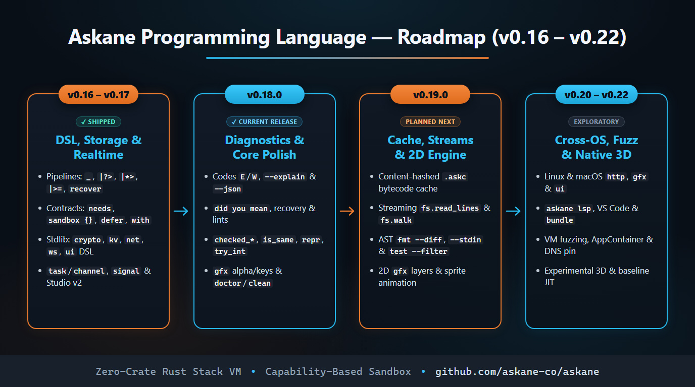

<div align="center">
  

  <h1>
    
    &nbsp;Askane (v0.20.0)
  </h1>

  <p>
    An experimental, bytecode-compiled scripting language written in Rust with <strong>zero external crate dependencies</strong>.
  </p>

  <p>
    <a href="https://github.com/askane-co/askane/releases/latest/download/askane.exe">
      
    </a>
    <a href="https://github.com/askane-co/askane/releases/latest">
      
    </a>
    <a href="https://github.com/askane-co/askane/releases">
      
    </a>
    <a href="https://github.com/askane-co/askane/actions/workflows/ci.yml">
      
    </a>
    <a href="LICENSE">
      
    </a>
  </p>

  <p>
    <a href="#quick-start">Quick Start</a>
    &nbsp;&middot;&nbsp;
    <a href="#repository-map">Repository Map</a>
    &nbsp;&middot;&nbsp;
    <a href="examples/README.md">Examples</a>
    &nbsp;&middot;&nbsp;
    <a href="docs/SYNTAX.md">Language Spec</a>
    &nbsp;&middot;&nbsp;
    <a href="docs/diagnostics.md">Diagnostics</a>
    &nbsp;&middot;&nbsp;
    <a href="#built-in-functions--modules">Stdlib (63)</a>
    &nbsp;&middot;&nbsp;
    <a href="bench/README.md">Benchmarks</a>
    &nbsp;&middot;&nbsp;
    <a href="SECURITY_AUDIT.md">Security Audit</a>
    &nbsp;&middot;&nbsp;
    <a href="ROADMAP.md">Roadmap</a>
  </p>
</div>

> **Transparency note**: This language and its runtime were designed and built in collaboration with **Gemini** and **ChatGPT** (AI-assisted development). Published as an open beta so anyone can inspect the VM, run benchmarks, test the sandbox, and suggest improvements.

## Quick Start

**Fastest way (Windows, no Rust required):**

1. [Download `askane.exe` (4.4 MB single binary)](https://github.com/askane-co/askane/releases/latest/download/askane.exe) from the [latest release](https://github.com/askane-co/askane/releases/latest).
2. Launch the **Askane Studio v2** GUI editor, open the REPL, or associate `.ask` files for 1-click launch:

```powershell
# Launch Askane Studio v2 GUI editor
.\askane.exe --gui

# Optional: add askane to PATH and register .ask double-click file association
.\askane.exe setup

# Start interactive REPL (:gui inside REPL also opens Studio)
.\askane.exe
```

**Build & run from source (requires Rust `cargo`):**

```bash
cargo build --release
cargo run -- examples/hello.ask
./target/release/askane run examples/neon_dodge
./target/release/askane -b examples/pipeline.ask
```

## Repository Map

Everything in the repository is organized for one-click browsing:

| Path | What You Will Find | Open |
| --- | --- | --- |
| `examples/` | Runnable scripts, `pong.ask`, `neon_dodge/` 2D game, procedural PNG generator | [Browse examples](examples/README.md) |
| `docs/` | Full language specification ([`SYNTAX.md`](docs/SYNTAX.md)) & visual assets | [Browse docs](docs/README.md) |
| `src/` | Compiler, bytecode VM, Studio v2 GUI, and 63 zero-crate stdlib modules | [Codebase tour](src/README.md) |
| `bench/` | 5-suite benchmark comparing Askane VM against Python and Node.js | [Benchmark suite](bench/README.md) |
| `ROADMAP.md` | Released history and detailed `0.20.0` (media, maps, 3D files, VM speedup) -> `0.22.0` (`gfx3d`) plan | [View roadmap](ROADMAP.md) |
| `SECURITY_AUDIT.md` | Sandbox threat model, capability flags, and security findings | [Read audit](SECURITY_AUDIT.md) |
| `LICENSE` | MIT License (`askane-co`) | [Read license](LICENSE) |

## Highlights

- **Single standalone binary**: lexer, AST parser, bytecode compiler, register/stack fast VM (`execute_fast`), and a rich standard library in pure Rust with zero Cargo dependencies.
- **Expression-first syntax**: `{ ... }` blocks, `if`/`else`, `match`, pipelines (`|>`, `|?>`, `|*>`, `|>=`, `_`), inline `recover`, tagged templates (`log"..."`, `sql"..."`), `struct`, `set`, `bytes`, and built-in `spec` tests.
- **Sandbox & contracts**: default-deny permissions for network, filesystem outside root, env, args, clipboard, global input, and process execution, plus `needs` declarations and `sandbox { ... }` privilege attenuation.
- **Built-in tooling**: multiline REPL, `.askc` bytecode cache (`--no-cache`, cleaned via `askane clean`), `askane check [--diagnostic-format=json]`, `askane --explain E0401`, `askane info`, `askane doctor`, `askane modules`, `askane clean`, `askane fmt [--check] [--diff] [--stdin]`, `askane test [--deterministic] [--update-snapshots] [--filter=<pattern>]`, `askane permissions`, `askane init`, `askane setup`, benchmark suite (`bench/`), and Windows Askane Studio v2 (`--gui`) with project explorer, tabs, search/replace, line numbers, and permissions toggles.

## How It Works Under the Hood

Askane runs as a classic 4-stage pipeline in a single standalone binary:

1. **Lexer** ([`src/lexer.rs`](src/lexer.rs)): scans `.ask` source code into tokens with line/column spans.
2. **Parser** ([`src/parser.rs`](src/parser.rs)): builds an AST ([`src/ast.rs`](src/ast.rs)). Blocks, `if`/`else`, and `match` are expressions, and `|>` desugars `x |> f(a)` into `f(x, a)`.
3. **Bytecode Compiler** ([`src/compiler.rs`](src/compiler.rs), [`src/bytecode.rs`](src/bytecode.rs)): compiles the AST into stack-VM opcodes, resolving local variable slots, lexical closures (upvalues), loops, and `match` jumps.
4. **Stack VM & Modules** ([`src/vm.rs`](src/vm.rs), [`src/value.rs`](src/value.rs), [`src/modules/`](src/modules/mod.rs)): executes verified bytecode (with `.askc` content-hashed caching and `ASKANE-PAK` single-file bundles) on a value stack with built-in functions and 63 standard modules (`math`, `fs`, `sys`, `json`, cross-platform `gfx`/X11, `audio`/ALSA, `http`/OpenSSL, 2D/3D/scene, and Windows `ui`/`mem`).

## Quick Syntax Overview

```askane
// Everything is an expression
let x = {
    let a = 10;
    a * 2
};

// Pipelines with short lambdas
range(1, 7)
    |> filter(|n| n % 2 == 0)
    |> map(|n| n * n)
    |> println;

// Pattern matching with guards and string interpolation
let label = match x {
    0 => "zero",
    n if n > 10 => "big: ${n}",
    other => "value: ${other}",
};

// Dictionaries, dot-assignment, optional chaining (?.) and ??
let player = #{ name: "Askane", hp: 100 };
player.hp = 90;
let mana = player?.mana ?? 50;
println("${player.name}: hp=${player.hp}, mana=${mana}", keys(player));

// Error handling with try / catch and inline recover
let parsed = try {
    if mana < 0 { throw "invalid mana"; }
    mana
} catch err {
    0
};
let safe_double = { int(player?.hp) * 2 } recover => 0;

// Pipelines with placeholder _, elementwise map |*>, and built-in spec tests
let scaled = [1, 2, 3] |*> (_ * 10) |> (_ + [40]);
spec "player mana stays non-negative" {
    import test;
    test.assert_eq(parsed >= 0, true);
}
```

> Want more? Check out [`examples/pong.ask`](examples/pong.ask), [`examples/neon_dodge/`](examples/neon_dodge/main.ask), [`examples/logo_gen.ask`](examples/logo_gen.ask), or the full [`Language Spec`](docs/SYNTAX.md).

## Built-in Functions & Modules

<details>
<summary><strong>Global built-in functions (I/O, collections, types, checked arithmetic)</strong></summary>

- **I/O:** `print(...)`, `println(...)`, `read_line()`
- **Collections & Strings:** `len(x)`, `push(list, val)`, `pop(list)`, `range(end)` / `range(start, end)`, `keys(dict)`, `values(dict)`, `entries(dict)`, `get(dict, key, [default])`, `remove(collection, key_or_idx)`, `sort(list)`, `reverse(list_or_str)`, `unique(list)`, `flatten(list)`, `chunk(list, size)`, `sum(seq)`, `has(dict, key)`, `first(seq)`, `last(seq)`, `is_empty(seq)`
- **Higher-order & Sequences:** `map(seq, fn)`, `filter(seq, fn)`, `reduce(seq, init, fn)`, `enumerate(seq)`, `zip(a, b)`, `take(seq, n)`, `skip(seq, n)`, `any(seq, fn)`, `all(seq, fn)`, `find(seq, fn)`, `find_index(seq, pred)`, `count(seq, pred)`, `partition(seq, pred)`, `flat_map(seq, fn)`, `take_while(seq, pred)`, `drop_while(seq, pred)`, `zip_longest(a, b, [fill])`, `min_by(seq, key_fn)`, `max_by(seq, key_fn)`
- **Conversions, Arithmetic & Types:** `str(x)`, `repr(x)`, `int(x)`, `try_int(x)`, `float(x)`, `try_float(x)`, `type_of(x)`, `is_same(a, b)`, `is_unit(x)`, `is_int(x)`, `is_float(x)`, `is_bool(x)`, `is_str(x)`, `is_bytes(x)`, `is_list(x)`, `is_dict(x)`, `is_set(x)`, `is_fn(x)`, `checked_add(a, b)`, `checked_sub(a, b)`, `checked_mul(a, b)`, `wrapping_add(a, b)`, `wrapping_sub(a, b)`, `wrapping_mul(a, b)`, `clock()`

</details>

<!-- askane:modules:begin -->
<details>
<summary><strong>All 63 standard library modules (<code>import &lt;name&gt;;</code> — auto-synced from <code>src/registry.rs</code>)</strong></summary>

- [`archive`](src/modules/archive.rs): Sandboxed ZIP pack/create/list/read_entry/extract with Zip-Slip & size guards — `pack`, `create`, `list`, `read_entry`, `extract`
- [`assets`](src/modules/assets.rs): Unified budget-aware asset cache, VFS ASKANE-PAK/ZIP mounts & manifest hints — `load_image`, `load_texture`, `load_sound`, `sound`, `read_bytes`, `read_text`, `exists`, `mount`, `mount_bytes`, `unmount`, `entries`, `list`, `set_budget`, `gc`, `stats`, `clear`, `reset`
- [`audio`](src/modules/audio.rs): Deterministic multi-channel audio mixer, streaming music, synth & offline render — `init`, `shutdown`, `sink_name`, `state`, `poll_errors`, `load`, `stream`, `music_load`, `music_play`, `music_stop`, `music_pause`, `music_resume`, `music_seek`, `music_position_ms`, `music_duration_ms`, `music_set_volume`, `music_set_loop`, `music_set_loop_points`, `music_fade_to`, `music_state`, `music_close`, `from_samples`, `tone`, `noise`, `render_offline`, `bus`, `bus_new`, `bus_set_volume`, `bus_set_mute`, `bus_set_effect`, `bus_stop_all`, `play`, `play_at`, `stop`, `stop_all`, `pause_all`, `resume_all`, `set_listener`, `clock_ms`, `tick`, `voice_stop`, `voice_pause`, `voice_resume`, `voice_set_volume`, `voice_set_pan`, `voice_set_pitch`, `voice_set_loop`, `voice_set_loop_points`, `voice_fade_to`, `voice_set_pos3`, `voice_is_playing`, `voice_position_ms`, `ENGINE_RATE`, `SAMPLE_RATE`, `CHANNELS`, `QUANTUM`, `MAX_VOICES`, `MAX_BUSES`, `MAX_MUSICS`
- [`base64`](src/modules/base64.rs): Standard and URL-safe Base64 encoding and decoding — `encode`, `decode`, `decode_bytes`, `encode_url`, `decode_url`, `decode_url_bytes`
- [`binary`](src/modules/binary.rs): Binary struct pack/unpack and typed integer/float codecs — `pack`, `unpack`, `read_u16_le`, `read_u16_be`, `read_u32_le`, `read_u32_be`, `read_i32_le`, `read_i32_be`, `read_i64_le`, `read_i64_be`, `read_f32_le`, `read_f32_be`, `read_f64_le`, `read_f64_be`, `write_u16_le`, `write_u16_be`, `write_u32_le`, `write_u32_be`, `write_i64_le`, `write_i64_be`, `write_f32_le`, `write_f64_le`
- [`buffer`](src/modules/buffer.rs): Typed binary buffers (u8/i32/u32/f32) with safe element views and BudgetCore tracking — `new`, `len`, `byte_len`, `elem_type`, `get`, `set`, `fill`, `fill_rgba`, `blit`, `copy_from`, `slice`, `clone`, `as_bytes`, `from_bytes`
- [`bytes`](src/modules/bytes.rs): Byte buffer conversions and zero-allocation helpers — `from_utf8`, `from_utf8_lossy`, `to_utf8`, `from_str`, `from_list`, `to_list`, `zeros`
- [`channel`](src/modules/task.rs): Bounded MPSC channels with cooperative deadlock detection — `bounded`, `send`, `try_send`, `recv`, `try_recv`, `close`, `len`, `is_closed`
- [`cli`](src/modules/cli.rs): Command-line flags & positional arguments parser — `parse`, `has_flag`
- [`clipboard`](src/modules/clipboard.rs) (windows, macos): Desktop clipboard text read/write via Win32 or pbcopy/pbpaste (requires --allow-clipboard) — `get_text`, `set_text`
- [`collections`](src/modules/collections.rs): deque, counter, priority_queue, groupby, window & sequence helpers — `deque`, `counter`, `priority_queue`, `groupby`, `window`, `first`, `last`, `is_empty`, `find_index`, `count`, `partition`, `flat_map`, `take_while`, `drop_while`, `zip_longest`, `min_by`, `max_by`
- [`compress`](src/modules/compress.rs): Pure-Rust DEFLATE, Zlib, Gzip compression, CRC32 and Adler32 — `deflate`, `inflate`, `zlib_compress`, `zlib_decompress`, `gzip_compress`, `gzip_decompress`, `crc32`, `adler32`
- [`crypto`](src/modules/crypto.rs): HMAC-SHA256, constant_time_eq, random_key, ChaCha20-Poly1305 AEAD — `hmac_sha256`, `hmac_sha256_hex`, `constant_time_eq`, `random_key`, `random_bytes`, `seal`, `open`
- [`csv`](src/modules/csv.rs): RFC-compatible CSV parsing, dict rows, and serialization — `parse`, `parse_dicts`, `stringify`
- [`cubemap`](src/modules/cubemap.rs): 6-face square power-of-two cubemaps and directional sampling — `load`, `from_colors`, `sample`, `size`, `close`, `free`
- [`datetime`](src/modules/datetime.rs): UTC timestamps, ISO-8601 parsing and formatting — `utc_now`, `from_timestamp`, `format`, `parse_iso`
- [`dialog`](src/modules/dialog.rs) (windows): Native Win32 alert, confirm and open/save dialogs — `info`, `confirm`, `open_file`, `save_file`
- [`diff`](src/modules/diff.rs): LCS line and value diff formatter — `lines`, `format`, `values`
- [`fs`](src/modules/fs.rs): Sandboxed filesystem, streaming I/O & ASKANE-PAK VFS reads — `read`, `write`, `append`, `exists`, `remove`, `remove_dir`, `list_dir`, `walk`, `mkdir`, `is_dir`, `read_bytes`, `write_bytes`, `read_lines`, `write_lines`, `open_lines`, `open_writer`, `write_stream`, `temp_file`, `copy`, `copy_dir`, `move`, `size`, `glob`
- [`geom`](src/modules/geom.rs): 2D/3D vectors, matrices, quaternions, rays, AABBs and frustums — `vec2`, `vec3`, `vec4`, `quat`, `quat_identity`, `quat_axis_angle`, `quat_euler`, `mat4`, `mat4_identity`, `mat4_translate`, `mat4_scale`, `mat4_rotate_x`, `mat4_rotate_y`, `mat4_rotate_z`, `mat4_from_quat`, `mat4_trs`, `mat4_look_at`, `mat4_perspective`, `mat4_ortho`, `mat4_mul`, `mat4_vec4`, `mat4_point`, `mat4_dir`, `mat4_transpose`, `mat4_det`, `mat4_inverse`, `x`, `y`, `z`, `w`, `to_list`, `rot90`, `rotate_vec2`, `rotate_vec3`, `deg_to_rad`, `rad_to_deg`, `dot`, `cross`, `len`, `len_sq`, `dist`, `normalize`, `lerp`, `slerp`, `conjugate`, `reflect`, `project`, `transform`, `transform_to_mat4`, `transform_point`, `transform_combine`, `aabb`, `aabb_contains`, `aabb_intersects`, `aabb_center`, `aabb_size`, `aabb_expand`, `aabb_transform`, `ray`, `ray_at`, `ray_aabb`, `ray_plane`, `plane`, `plane_from_point`, `plane_distance`, `frustum_from_mat4`, `frustum_contains_point`, `frustum_intersects_aabb`
- [`gfx`](src/modules/gfx.rs): 2D framebuffer graphics (Win32/raw X11 window & headless), sprites, cameras & fonts — `window`, `headless`, `is_open`, `clear`, `rect`, `rect_alpha`, `circle`, `circle_alpha`, `line`, `pixel`, `text`, `rect_outline`, `circle_outline`, `width`, `height`, `load_image`, `draw_image`, `draw_image_keyed`, `draw_sprite_frame`, `draw_sprite_ex`, `draw_atlas`, `atlas_rect`, `make_anim`, `anim_update`, `anim_draw`, `anim_frame`, `image_width`, `image_height`, `set_title`, `delta`, `present`, `key_down`, `key_pressed`, `mouse_x`, `mouse_y`, `mouse_down`, `mouse_pressed`, `close`, `clip`, `reset_clip`, `surface_new`, `surface_free`, `surface_width`, `surface_height`, `surface_from_image`, `draw_to`, `draw_surface`, `draw_surface_scaled`, `draw_surface_keyed`, `draw_surface_alpha`, `read_pixel`, `frame_hash`, `layer_new`, `layer_free`, `layer_mode`, `layer_visible`, `layer_z`, `layer_parallax`, `draw_to_layer`, `compose_layers`, `set_camera`, `camera`, `reset_camera`, `set_camera_shake`, `update_camera`, `world_to_screen`, `screen_to_world`, `mouse_world`, `font_bitmap`, `font_load_bmfont`, `font_free`, `draw_text`, `measure_text`, `text_line_height`, `text_width`
- [`glob`](src/modules/glob.rs): Linear/DP-bounded glob pattern matching — `match`
- [`hash`](src/modules/hash.rs): Non-keyed hashes: SHA-256, CRC32, FNV-1a — `sha256`, `crc32`, `fnv1a`
- [`hex`](src/modules/hex.rs): Hexadecimal byte encoding and decoding — `encode`, `decode`
- [`html`](src/modules/html.rs): HTML parser, selector, text extraction & escaping — `escape`, `unescape`, `parse`, `select`, `text`
- [`http`](src/modules/http.rs) (windows, linux): HTTPS client via WinHTTP (Windows) or OpenSSL dlopen (Linux, requires --allow-net) — `get`, `post`
- [`image`](src/modules/image.rs): Safe image decoding, pixel formats, color ops, mipmaps, atlases & textures — `new`, `from_bytes`, `decode`, `load`, `info`, `meta`, `digest`, `width`, `height`, `format`, `color_space`, `frame_count`, `frame`, `get_pixel`, `to_bytes`, `convert`, `to_linear`, `to_srgb`, `premultiply`, `crop`, `resize`, `flip`, `flip_x`, `flip_y`, `rotate`, `mipmaps`, `mip_count`, `mip_level`, `mip_digest`, `height_to_normal`, `texture`, `sample`, `atlas`, `atlas_from_paths`, `sprite_frame`
- [`ini`](src/modules/ini.rs): INI configuration parser and writer — `parse`, `stringify`
- [`input`](src/modules/input.rs) (windows): Global key/mouse polling and hotkeys (requires --allow-input) — `vk_code`, `key_name`, `key_down`, `key_pressed`, `hotkey`, `mouse_down`, `mouse_pos`
- [`json`](src/modules/json.rs): Strict JSON parser and serializer with depth and control-char guards — `parse`, `stringify`
- [`kv`](src/modules/kv.rs): Embedded append-only CRC32 KV store (sandbox-checked) — `open`, `get`, `set`, `delete`, `has`, `keys`, `prefix`, `batch`, `compact`, `len`, `close`
- [`lighting`](src/modules/lighting.rs): 2D/3D/spot lightmaps with shadow DDA & HDR compositing — `point`, `point3d`, `directional`, `spot`, `lightmap`, `clear`, `apply`, `composite`, `close`, `free`
- [`log`](src/modules/log.rs): Structured leveled logger with automatic secret redaction — `set_level`, `json`, `format`, `debug`, `info`, `warn`, `error`
- [`math`](src/modules/math.rs): Floating-point & scalar math helpers (sqrt, pow, sin, cos, clamp, lerp, atan2) — `sqrt`, `abs`, `pow`, `sin`, `cos`, `floor`, `ceil`, `round`, `min`, `max`, `clamp`, `lerp`, `dist`, `atan2`, `pi`, `e`
- [`mem`](src/modules/mem.rs) (windows): Process memory inspection (--unsafe + ASKANE_ENABLE_UNSAFE_MEM=1) — `current_pid`, `find_pid`, `open`, `close`, `module_base`, `read_i32`, `read_i64`, `read_f32`, `read_f64`, `read_bytes`, `write_i32`, `write_i64`, `write_f32`, `write_f64`
- [`mesh`](src/modules/mesh.rs): OBJ/glTF/GLB 3D model loading, stats, verification & ASKAS cache — `load`, `stats`, `aabb`, `nodes`, `materials`, `warnings`, `flatten`, `verify`, `close`, `free`
- [`nav`](src/modules/nav.rs): Deterministic A* grid pathfinding, string-pulling & flow fields — `grid`, `from_solid`, `from_tiled`, `from_terrain`, `set_cost`, `is_walkable`, `find_path`, `path_smooth`, `flow_field`, `info`, `close`, `free`
- [`net`](src/modules/net.rs): Sandboxed TCP & UDP sockets (requires --allow-net) — `tcp_listen`, `tcp_accept`, `tcp_connect`, `send`, `recv`, `udp_bind`, `udp_send_to`, `udp_recv_from`, `local_addr`, `peer_addr`, `close`
- [`os`](src/modules/os.rs): Host OS metadata, cwd, home/temp dirs, env & args — `platform`, `arch`, `family`, `cpu_count`, `pid`, `sep`, `line_ending`, `cwd`, `home_dir`, `temp_dir`, `env`, `args`
- [`particles`](src/modules/particles.rs): Deterministic PCG32 particle pools, emitters & rendering — `create`, `seed`, `set_gravity`, `spawn`, `emit`, `update`, `draw`, `count`, `clear`, `close`, `free`
- [`path`](src/modules/path.rs): Path manipulation (join, parent, name, stem, extension, normalize) — `join`, `parent`, `name`, `stem`, `extension`, `is_absolute`, `normalize`
- [`postfx`](src/modules/postfx.rs): Bloom, 3D LUT color grading, vignette, scanlines & BMP snapshots — `bloom`, `lut_load`, `lut_apply`, `lut_size`, `vignette`, `scanlines`, `snapshot`, `close`, `free`
- [`pprint`](src/modules/pprint.rs): Pretty formatter for nested structures — `format`, `print`
- [`process`](src/modules/process.rs): Subprocess execution in bounded sandbox (requires --allow-exec) — `run`
- [`procgen`](src/modules/procgen.rs): Deterministic fixed-point 2D noise, FBM heightmaps, normal maps & procedural patterns — `seed`, `hash2d`, `noise2d`, `perlin2`, `worley2`, `fbm2d`, `heightmap`, `normal_map`, `checker`, `cellular`, `scatter`
- [`random`](src/modules/random.rs): Deterministic PRNG and OS CSPRNG (crypto_int, crypto_bytes) — `seed`, `int`, `float`, `bool`, `choice`, `shuffle`, `crypto_int`, `crypto_bytes`
- [`regex`](src/modules/regex.rs): Step-bounded regular expression engine — `is_match`, `find`, `find_all`, `replace`
- [`scene`](src/modules/scene.rs): Unified scene assembly, terrain snapping & depth-tested drawing — `assemble`, `info`, `stats`, `entities`, `draw`, `close`, `free`
- [`signal`](src/modules/signal.rs): Reactive signal state cells with on change observers — `new`, `of`, `get`, `set`, `update`, `watch`, `unwatch`, `unwatch_all`
- [`strings`](src/modules/strings.rs): UTF-8 string utilities (split, trim, replace, slice, byte_len, truncate_utf8) — `split`, `trim`, `trim_start`, `trim_end`, `replace`, `contains`, `starts_with`, `ends_with`, `upper`, `lower`, `find`, `repeat`, `lines`, `pad_start`, `pad_end`, `slice`, `join`, `byte_len`, `eq_ignore_case`, `contains_ignore_case`, `strip_prefix`, `strip_suffix`, `split_once`, `rsplit_once`, `truncate_utf8`
- [`sys`](src/modules/sys.rs): CLI args, env vars, backend probes, process exit, budget & sleep — `args`, `env`, `exit`, `os`, `arch`, `sleep`, `budget`, `backends`
- [`task`](src/modules/task.rs): Cooperative green tasks (spawn, yield_now, sleep, join, select, timeout) — `spawn`, `yield_now`, `sleep`, `join`, `is_done`, `select`, `timeout`
- [`term`](src/modules/term.rs): ANSI terminal styling helpers — `red`, `green`, `yellow`, `cyan`, `bold`, `clear`
- [`terrain`](src/modules/terrain.rs): Heightmaps (.r16/PNG), normals, slopes, Mode7 & splatmaps — `load`, `from_image`, `info`, `height`, `height_at`, `normal`, `normal_at`, `slope`, `to_solid`, `to_mesh`, `splat_from_image`, `splat_weights`, `mode7_draw`, `close`, `free`
- [`test`](src/modules/test.rs): Assertions (assert, assert_eq, assert_ne, assert_err, assert_snapshot) — `assert`, `assert_eq`, `assert_ne`, `assert_err`, `assert_snapshot`
- [`tiled`](src/modules/tiled.rs): Tiled .tmj/.tmx map loading, solid collision grids & terrain alignment — `load`, `info`, `stats`, `layers`, `tile_at`, `solid_grid`, `is_solid`, `place_on_terrain`, `draw`, `close`, `free`
- [`time`](src/modules/time.rs): Monotonic & wall clock helpers (now_ms, now_sec, elapsed_ms, sleep_ms) — `now_ms`, `now_sec`, `elapsed_ms`, `sleep_ms`
- [`toml`](src/modules/toml.rs): Bounded TOML parser and serializer — `parse`, `stringify`
- [`ui`](src/modules/ui.rs) (windows): Declarative 2D UI layout and interactive widgets — `rgb`, `hex`, `color`, `theme`, `column`, `row`, `label`, `button`, `text_input`, `checkbox`, `slider`, `select`, `spacer`, `rect`, `image`, `nine_slice`, `icon_button`, `window`, `is_open`, `close`, `width`, `height`, `dpi_scale`, `set_theme`, `render`, `events`, `layout`, `state`, `set_state`, `inject_click`, `inject_key`, `inject_resize`, `wait`
- [`url`](src/modules/url.rs): URL parsing, percent-encoding/decoding and query helpers — `parse`, `encode`, `decode`, `query_parse`, `query_stringify`
- [`uuid`](src/modules/uuid.rs): Random UUID v4 generation — `v4`
- [`ws`](src/modules/ws.rs): RFC 6455 WebSocket server & client (requires --allow-net) — `listen`, `accept`, `connect`, `send`, `send_bytes`, `recv`, `local_addr`, `close`
- [`xml`](src/modules/xml.rs): XML tree parser, selector & escaping — `parse`, `select`, `text`, `escape`, `unescape`

</details>
<!-- askane:modules:end -->

<details>
<summary><strong>CLI commands reference (<code>askane --help</code>)</strong></summary>

- `askane` — multiline REPL (supports `:help`, `:gui`, `:exit`, `:reset`, `:modules`, `:bc`)
- `askane -e "<code>"` — evaluate inline Askane code (pass script args after `--`)
- `askane --gui [file.ask]` — Askane Studio v2 GUI editor & runner (Windows)
- `askane check [--json|--diagnostic-format=json] [--no-color] <file_or_dir>` — multi-error syntax/compile check + static warnings & asset audit (`E0565`, `W0501`/`W0502`)
- `askane --explain <E...|W...>` — explain diagnostic error or warning code
- `askane info` / `askane doctor` — runtime summary or backend/environment diagnostics
- `askane modules [--json | --markdown [--check]]` — list all 63 built-in standard library modules or verify synced docs
- `askane bundle <dir> [--out game.pak] [--embed out.exe] [--pack-askc]` — package into signed/hashed `ASKANE-PAK` single-file binary
- `askane lsp` — start stdio JSON-RPC 2.0 Language Server
- `askane clean [--dry-run] [--snapshots] [dir]` — clean `.askc` bytecode caches (`__askcache__/`) and temp artifacts
- `askane fmt [--check] [--diff] [--stdin] <file_or_dir>` — format Askane source code (reads `[fmt] indent` from `askane.toml`)
- `askane permissions <file.ask>` — inspect static capabilities & asset paths imported by a script
- `askane init [--name <name>] [--template app|game] [dir]` — create a starter Askane app or 2D game project
- `askane setup [--status|--all|--default=run|studio|--uninstall]` — add Askane to User PATH and register `.ask` file associations (Windows)
- `askane test [--deterministic] [--update-snapshots] [--filter=<pattern>] [--no-cache] <file_or_dir>` — run `.ask` test files in isolated VMs

</details>

## Security model

By default filesystem paths are checked against the script directory. Network access, `sys.env`, `sys.args`, `sys.exit`, and `mem` are blocked. The VM has a 10-million instruction budget per top-level run; source files are limited to 4 MiB and `fs.read` to 32 MiB. Graphics scripts exceeding the budget need `--max-steps` or trusted mode (`neon_dodge` configures its limits in [`askane.toml`](examples/neon_dodge/askane.toml)).

Granular permission flags are supported in addition to `--unsafe`:
- `--allow-net[=host[:port],...]`: allow HTTPS requests (all hosts or specific allowlist)
- `--allow-read[=dir,...]` / `--allow-write[=dir,...]`: allow reading/writing outside the script directory
- `--allow-env[=VAR,...]`: allow `sys.env()` / `os.env()` (all or specific variables)
- `--allow-args`: allow `sys.args()` / `os.args()`
- `--max-steps=N`: override the 10-million sandbox instruction budget
- `--timeout=MS`: override the 30-second sandbox wall-clock deadline
- `--allow-clipboard`: allow `clipboard.get_text()` and `clipboard.set_text()`
- `--allow-input`: allow global `input.key_down()`, `hotkey()`, `mouse_down()`, `mouse_pos()`
- `--allow-exec[=cmd,...]`: allow `process.run()` for specific executables or any command

`askane --unsafe script.ask` enables unrestricted files, HTTPS network requests and system functions. Memory access additionally requires `ASKANE_ENABLE_UNSAFE_MEM=1`. HTTPS requests verify certificates using WinHTTP, disable automatic redirects and ambient Windows authentication, and use per-operation timeouts. HTTP errors omit URLs to avoid leaking query-string credentials. The API example requires `--allow-net=httpbin.org` or `--unsafe`.

This is an in-process policy, **not an OS security boundary**: filesystem checks are not atomic with opening files, hard links are not isolated, memory is not fully metered, and graphics/console I/O remain available. Run hostile scripts in an OS-isolated environment without sensitive files. HTTPS is encryption, not anonymity: a contacted server can see your public IP address. See [SECURITY_AUDIT.md](SECURITY_AUDIT.md) for findings and [ROADMAP.md](ROADMAP.md) for proposed next releases.

## Roadmap

<a href="ROADMAP.md">
  
</a>

Click [ROADMAP.md](ROADMAP.md) for the full milestone breakdown (`v0.20.0` media, maps, terrain, `.obj`/`.gltf` 3D assets, VM speedup & LSP -> `v0.22.0` `gfx3d`).

## Mascot

Askane's official mascot is a **Plecostomus** (**Pleco**), a humble little armored catfish that bravely cleans up messy code and keeps the tank spotless.

## License

[MIT](LICENSE)
