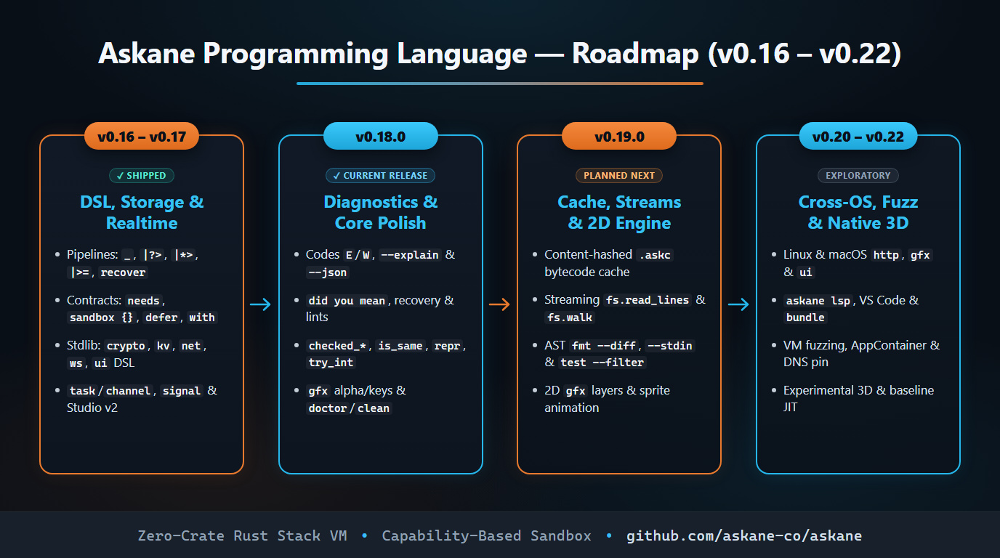

# Askane Roadmap

Release roadmap for Askane, separated into completed milestones, immediate fixes, planned releases, and long-term exploratory ideas.

## Version Status

| Version | Status | Primary Goal |
| --- | --- | --- |
| `0.11.0` | **Done** | Granular capability flags, `try`/`catch`/`throw`, lazy `range` |
| `0.12.0` | **Done** | Askane Studio GUI, multiline REPL, `check`/`test`, core stdlib (8 modules) |
| `0.13.0` | **Done** | Destructuring, lazy sequences, GUI Job Object, `verify_proto`, `--timeout`, `hash`/`ini`/`datetime`/`clipboard` |
| `0.14.0 - 0.14.1` | **Done** | Extended syntax (`+=`, `in`, `loop`, slices, list comprehensions, `match` ranges), 9 modules, BMP sprites, `fmt`/`init`, interactive stdin |
| `0.14.2-fix` | **Next** | Compiler stack-slot offset fix (`compiler.rs`) and Job Object isolation for CLI `process.run()` |
| `0.15.0` | **Planned** | Multi-file `.ask` projects & modules, VM performance + native `bytes`, basic `struct` & `set` |
| `0.16+` | **Exploratory** | Signature pipelines (`|?>`, `|*>`, `recover`), `needs`/`sandbox` contracts, `with`/`defer`, networking, and storage |

---

## Zero-Crate Philosophy and Trade-offs

Askane targets a single compact binary (~1.6 MB) without pulling dozens of third-party crates into `Cargo.lock`. In practice, this follows two rules:

1. **Simple parsers and core algorithms are written in-house.** The lexer, parser, compiler, bytecode VM, JSON, CSV, INI, URL, BMP decoder, CRC32/SHA-256, and a bounded linear-time `regex` subset live in the codebase with strict input-size limits.
2. **OS cryptography, process isolation, and UI are delegated to the platform.** CSPRNG (`BCryptGenRandom`), dialogs/windows, audio (`winmm.dll`), clipboard, and Job Objects use native Windows system libraries instead of reimplementing OS primitives from scratch. Where cross-platform portability or complex standards are needed (TLS/HTTPS, compression, embedded DB engines), the trade-off between system APIs, a minimal audited crate, or a bounded built-in subset is evaluated per feature.

---

## Completed Releases (`Done`)

### `0.11.0 - 0.12.0` - Language Core, Sandbox, and Studio [Done]
- **Capability model and isolation:** granular flags (`--allow-net`, `--allow-read`, `--allow-write`, `--allow-env`, `--allow-args`, `--allow-gfx`), step budgets (`--max-steps`), and capability inheritance across imports without privilege escalation.
- **Language and runtime:** `try / catch / throw`, lazy `range`, deterministic collection helpers (`keys`, `values`, `entries`, `get`, `remove`, `sort`, `reverse`).
- **Tooling:** multiline REPL (`:reset`, `:modules`, `:bc`), source-snippet diagnostics, `askane check [--json]`, and `askane test`.
- **Askane Studio GUI:** built-in Win32 editor and runner executing scripts in an isolated child process.
- **Stdlib:** `strings`, `path`, `time`, `random` (CSPRNG rejection sampling), `base64`, `csv`, `log`, and `test`.

### `0.13.0` - Tooling, Safety Hardening, and Sequences [Done]
- **Syntax and sequences:** destructuring (`let [a, b] = ...`, `let #{ name, hp } = ...`), `enumerate`, `zip`, `take`, `skip`, `any`, `all`, and `find`.
- **CLI and GUI:** `askane -e`, `askane permissions`, `askane check <dir>`, `:gui` from REPL, Windows Job Object for `Stop`, and editor shortcuts (`F5`, `Ctrl+S`, `Ctrl+O`, `Ctrl+A`).
- **VM hardening:** pre-execution bytecode verifier (`verify_proto`), wall-clock `--timeout`, secret redaction in `log`, and opaque `mem` handles with PID checks and automatic close on drop.
- **Stdlib:** `hash` (`sha256`, `crc32`, `fnv1a`), `ini`, `datetime`, and `clipboard` (`--allow-clipboard`).

### `0.14.0 - 0.14.1` - Expressive Syntax, Assets, and CLI [Done]
- **Language:** compound assignment (`+=`, `-=`, `*=`, `/=`), `in` operator, `loop`, raw strings `r"..."`, multiline strings `"""..."""`, `for k, v in dict` unpacking, slices (`[a..b]`, `[a..=b]`, `[..b]`, `[a..]`), list comprehensions `[x for x in seq if cond]`, integer ranges in `match` (`0..50`, `80..=100`), and `unique`, `flatten`, `chunk`, `sum`.
- **Files and graphics:** `fs.read_bytes`, `fs.write_bytes`, `fs.copy`, `fs.move`, `fs.size`, and `fs.glob` with atomic temp-file writes and symlink overwrite refusal; BMP sprites in `gfx` (`load_image`, `draw_image`, `draw_image_keyed`, `rect_outline`, `circle_outline`, `set_title`, `delta`) with header validation.
- **Stdlib:** `audio`, `url`, `hex`, `uuid` (v4 via `BCryptGenRandom`), `term`, `glob`, `regex`, `dialog`, `process` (`--allow-exec`), and `math` extensions (`clamp`, `lerp`, `dist`, `atan2`).
- **Tooling and Studio (`0.14.1`):** `askane init`, `askane fmt [--check]`, GUI `Check` button, `Dark` theme toggle, and interactive `stdin` input + `Send` button.

---

## Next Up (`Next`)

### `0.14.2-fix` - Hotfix [Next]
- **Compiler (`compiler.rs`):** fix stack-slot calculation in `Expr::ListComp` (and `Block` / `Match` / `TryCatch`) when compiled inside compound expressions where temporary operands (such as a field receiver or call arguments) already sit on the VM stack.
- **`process.run()` in CLI:** execute child processes inside a shared Windows Job Object / worker with enforced `--timeout` and output-size limits, matching Studio GUI behavior.

---

## Upcoming Release (`Planned`)

### `0.15.0` - Modules, VM Speed, `bytes`, and Data Types [Planned]

This release focuses on three coherent areas needed for multi-file programs and games:

1. **Multi-file `.ask` projects:**
   - resolve relative imports against the importing module's directory while staying inside `sandbox_root`;
   - selective imports (`from "./player.ask" import Player, spawn;`), `pub` visibility, and directory modules (`mod.ask`);
   - `askane.toml` entry point (`entry = "src/main.ask"`) and `is_main()` guard.
2. **VM performance and `bytes`:**
   - specialized opcodes for hot loops, globals, and field access;
   - first-class `bytes` type (`b"..."`, `b[i]`, `b[a..b]`) backed by `Vec<u8>` instead of integer lists;
   - unified `ResourceBudget` tracking allocations and memory (`--max-mem=MB`) plus `--profile`.
3. **Data structures and ergonomics:**
   - basic `struct` with methods (`self`), value equality, and dict/JSON serialization;
   - built-in `set(...)` type with $O(1)$ membership (`x in s`);
   - default function parameters, `not in`, chained comparisons (`0 <= x <= 10`), and string/list methods.

---

## Long-Term Ideas (`Exploratory`)

These items are tracked for `0.16+` as exploratory directions rather than committed release scope, and move into `Planned` as concrete needs arise:

- **Signature Askane pipelines (`0.16`):** `_` placeholder in pipelines, short-circuit `|?>` and element-wise `|*>` operators, inline `recover` error handling, typed string templates (such as `sql"..."` separating template and values), and debug interpolation `${x=}`.
- **Syntax-level safety contracts:** declarative `needs net("host"), read("./data")`, local capability attenuation via `sandbox { ... }`, deterministic resource cleanup (`with` / `defer`), and built-in `spec "..." { ... }` test blocks.
- **Concurrency, networking, and runtime extensions:** generators (`yield`), `async`/`await` with `task`/`channel`, TCP/UDP (`net`) and WebSockets (`ws`), portable Linux/macOS backends for `http`/`gfx`/`clipboard`, `askane lsp`, standalone `askane bundle`, cycle GC, embedded KV storage, CNG-backed crypto, and gated FFI.
- **OS isolation hardening (P2):** Windows AppContainer / restricted tokens, DNS rebinding protection in `http`, directory-handle file access without TOCTOU, and a fuzzing corpus for lexer/parser/bytecode/VM.
